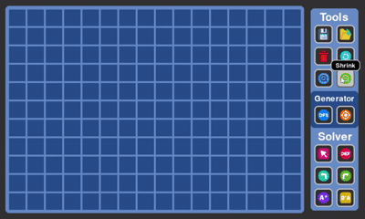
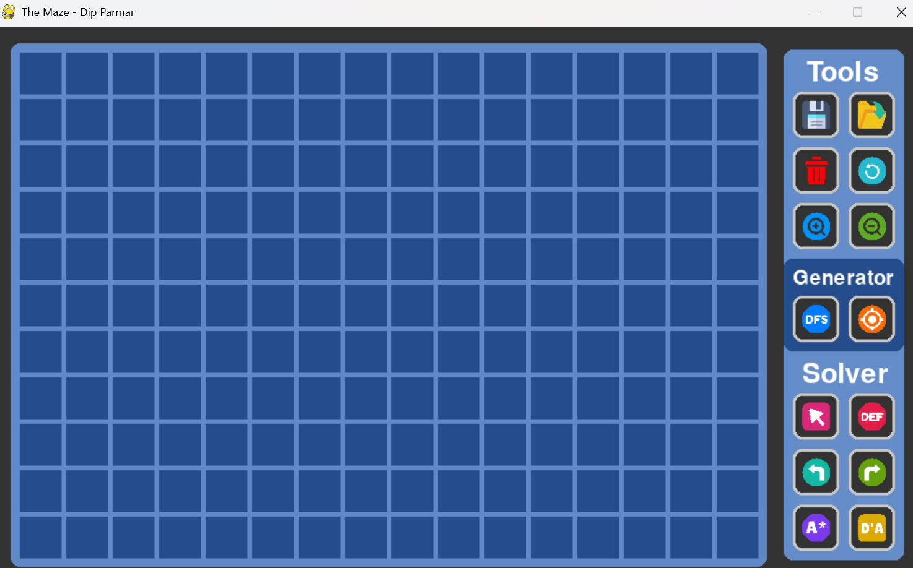
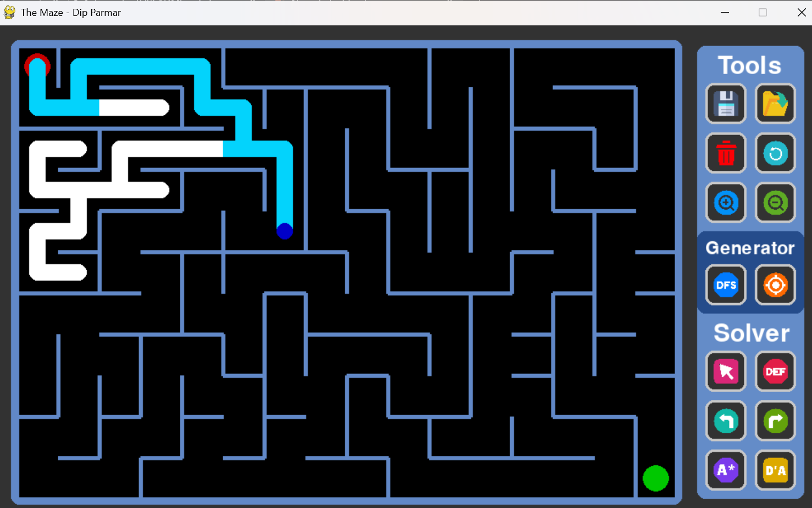
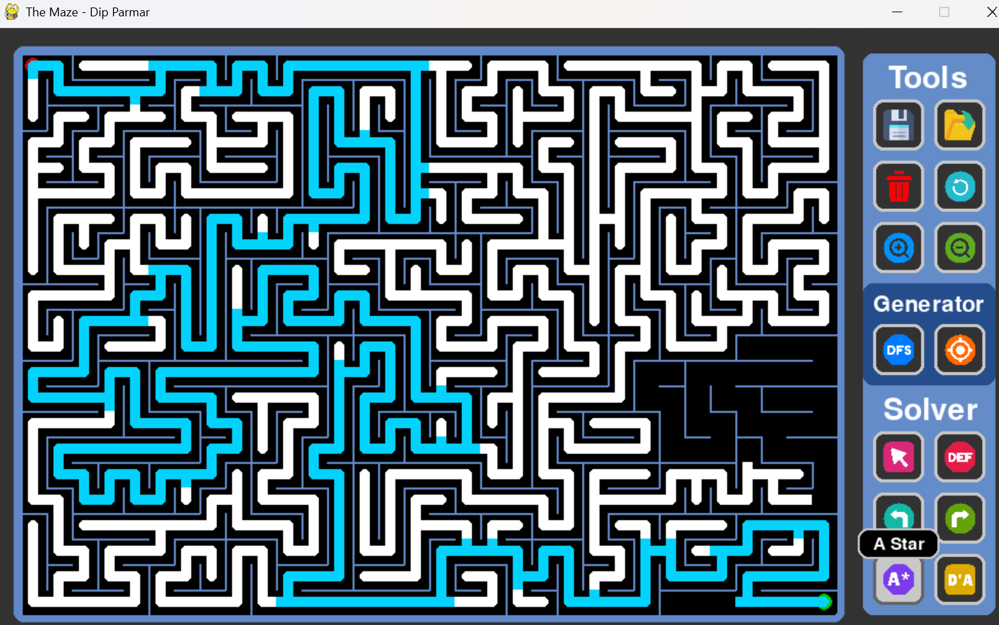
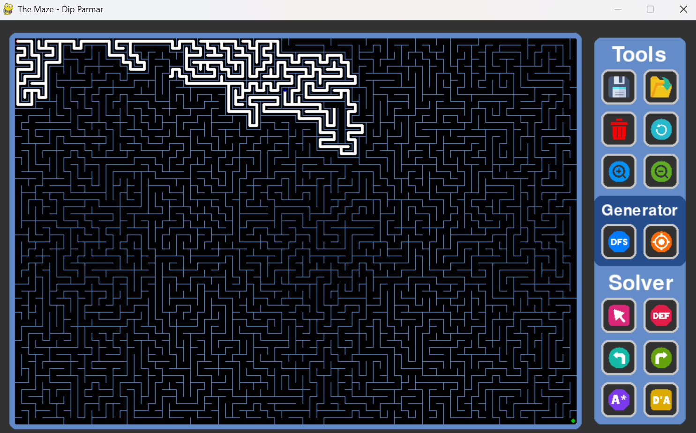
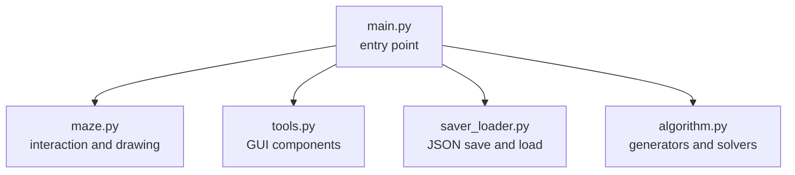

# 🧭 The Maze

[](LICENSE)
[](https://www.python.org/)
[](https://www.pygame.org/)
[](#-installation)

**The Maze** is an interactive maze **generation and solving visualizer** built from scratch with Python and Pygame. Generate a maze with one click, watch it being carved cell by cell, then pick a solver and see exactly how each algorithm thinks, explores, and finds its way out. You can also take the controls and solve the maze yourself with the keyboard.

Every algorithm runs inside a single-threaded, frame-by-frame animation loop, so what you see on screen is the algorithm's real step-by-step behavior, not a pre-recorded effect.

---

## 📸 Demo

> 🎬 **Full project walkthrough**



### Screenshots

| Empty Canvas & Toolbar | Solver in Action (11 × 16) |
| :---: | :---: |
|  |  |

| A* on a Medium Maze (22 × 32) | Largest Maze Mid-Exploration (55 × 80) |
| :---: | :---: |
|  |  |

*Maze sizes are written as rows × columns.*

---

## 📦 Table of Contents

- [Features](#-features)
- [Installation](#-installation)
- [Usage](#-usage)
- [Controls](#-controls)
- [Visual Legend](#-visual-legend)
- [Algorithms](#-algorithms)
- [Technical Details](#-technical-details)
- [Project Structure](#-project-structure)
- [Contributing](#-contributing)
- [License](#-license)
- [Acknowledgements](#-acknowledgements)

---

## ✨ Features

### 🏗️ Maze Generation
- **Two generation algorithms:** Depth-First Search and Hunt and Kill.
- Watch the maze being carved in real time.

### 🧠 Maze Solving
- **Six solving algorithms:** Random Mouse, Dead-End Fill, Right Hand, Left Hand, A\*, and Dijkstra.
- Live visualization of the **current position**, **visited cells**, and **final path**.

### 🎮 Manual Play
- As soon as a maze is generated, you can solve it yourself with **WASD** or the **arrow keys**. There is no button to press; manual play is always active after generation.

### 🔍 Three Zoom Levels
- **Zoom In** steps the tile size up through **10 → 25 → 50 px**, and **Zoom Out** steps it back down through **50 → 25 → 10 px**.
- Because the canvas is a fixed 800 × 550 pixels, the tile size decides the maze size: 10 px gives the largest maze (**55 rows × 80 columns**), 25 px a medium one (**22 × 32**), and 50 px the smallest (**11 × 16**).

### 💾 Save & Load
- Save any maze under a name of your choice and reload it later.
- Mazes are stored as compact `.json` files using a **bitmask encoding** (one integer per cell).

### 🧰 Toolbar
- **Save**, **Load**, **Delete** (remove the current maze), **Reset** (clear the solved path), **Zoom In**, and **Zoom Out**.
- Hover tooltips on the buttons.

---

## 📥 Installation

### Prerequisites
- **Python 3.11** (developed with 3.11.4)
- **pygame 2.6.1**

The project was developed and tested on **Windows**. Since Pygame is cross-platform it should also run elsewhere, but other operating systems have not been tested.

### Step 1: Clone the repository
```bash
git clone https://github.com/TechnicalCoderji/The-Maze.git
cd The-Maze
```

### Step 2 (optional): Create a virtual environment
```bash
python -m venv venv

# Windows
venv\Scripts\activate

# macOS / Linux
source venv/bin/activate
```

### Step 3: Install dependencies
```bash
pip install -r requirements.txt
```

### Step 4: Create the save folder
Saved mazes are stored in a folder named `MazeGrids`. It is **not** created automatically and is not included in the repository, so create it once in the project root:
```bash
mkdir MazeGrids
```

### Step 5: Run the application
```bash
python main.py
```

---

## 🕹️ Usage

1. **Generate a maze:** in the **Generator** panel, click **DFS** or **Hunt and Kill**.
2. **Choose a size:** use **Zoom In** (10 → 25 → 50 px) and **Zoom Out** (50 → 25 → 10 px) to switch between the three maze sizes.
3. **Solve it:** in the **Solver** panel, click an algorithm and watch it work. Use **Reset** to clear the path and try a different solver on the same maze.
4. **Or play it yourself:** use **WASD** or the **arrow keys** right after generation.
5. **Save your maze:** click **Save**, type a name, and click the second **Save** button to confirm. The file is written to `MazeGrids/` (make sure you created this folder in [Installation](#-installation)).
6. **Load a maze:** click **Load** and choose a saved maze.
7. **Start fresh:** click **Delete** to remove the current maze.

### 🧩 Toolbar Reference

| Panel | Button | Action |
| :--- | :---: | :--- |
| **Tools** | 💾 Floppy disk | Save the current maze |
| **Tools** | 📂 Folder | Load a saved maze |
| **Tools** | 🗑️ Trash can | Delete the generated maze |
| **Tools** | 🔄 Circular arrow | Reset (clear the solved path) |
| **Tools** | 🔍 Plus lens | Zoom In (tile size 10 → 25 → 50 px) |
| **Tools** | 🔍 Minus lens | Zoom Out (tile size 50 → 25 → 10 px) |
| **Generator** | **DFS** | Generate with Depth-First Search |
| **Generator** | 🎯 Target | Generate with Hunt and Kill |
| **Solver** | 🖱️ Pink cursor | Random Mouse |
| **Solver** | **DEF** | Dead-End Fill |
| **Solver** | ↰ Teal arrow | Left Hand follower |
| **Solver** | ↱ Green arrow | Right Hand follower |
| **Solver** | **A\*** | A Star |
| **Solver** | **D'A** | Dijkstra |

---

## ⌨️ Controls

| Key | Action |
| :---: | :--- |
| `W` / `↑` | Move up |
| `A` / `←` | Move left |
| `S` / `↓` | Move down |
| `D` / `→` | Move right |

Manual play starts automatically after a maze is generated. Walls block your movement.

---

## 🎨 Visual Legend

| Marker | Meaning |
| :---: | :--- |
| 🔴 Red circle | Start (top-left) |
| 🟢 Green circle | Goal (bottom-right) |
| 🔵 Blue dot | Current position |
| ⚪ White | Visited cells |
| 🟦 Cyan | Current / final path |

---

## 🧠 Algorithms

All algorithms live in [`algorithm.py`](algorithm.py).

### 🏗️ Generators

Both generators produce **perfect mazes**: every cell is reachable and there is exactly one path between any two cells.

| Algorithm | Approach | Behavior |
| :--- | :--- | :--- |
| **DFS** (Depth-First Search) | Carve a passage to a random unvisited neighbor, backtrack when stuck | Long, winding corridors with relatively few branches |
| **Hunt and Kill** | Random walk until stuck, then scan the grid ("hunt") for an unvisited cell next to the maze and continue from there | Winding passages similar to DFS, built without a deep backtracking stack |

### 🔎 Solvers

| Algorithm | Type | Optimal? | Behavior |
| :--- | :--- | :---: | :--- |
| **Random Mouse** | Stochastic, blind | ❌ | Picks a random open direction at each step; may revisit cells many times before stumbling on the goal |
| **Dead-End Fill** | Elimination | ✅ in perfect mazes | Repeatedly fills in dead ends until only the route to the goal remains |
| **Right Hand** | Wall follower | ❌ | Keeps its right hand on the wall; deterministic and needs no memory |
| **Left Hand** | Wall follower | ❌ | Mirror image of Right Hand; keeps its left hand on the wall |
| **A\*** | Informed search | ✅ | Priority queue ordered by path cost plus a heuristic estimate, so it heads toward the goal |
| **Dijkstra** | Uninformed shortest path | ✅ | Expands outward uniformly from the start, always guaranteeing the shortest route |

> 💡 **Try this:** solve the same maze with **Dijkstra** and then **A\***. Both find the shortest path, but notice how many fewer white (visited) cells A\* needs.

---

## 🔬 Technical Details

### 📐 Grid Dimensions

The maze canvas is **800 × 550 pixels**. The zoom level sets the tile size, which in turn sets the maze dimensions (rows × columns):

| Tile Size | Maze Size (rows × columns) | Total Cells | Scale |
| :---: | :---: | :---: | :--- |
| **10 px** | 55 × 80 | 4,400 | Largest maze |
| **25 px** | 22 × 32 | 704 | Medium maze |
| **50 px** | 11 × 16 | 176 | Smallest maze |

**Zoom In** moves down this table's rows from top to bottom (10 → 25 → 50 px), producing smaller mazes with bigger tiles. **Zoom Out** does the reverse (50 → 25 → 10 px).

### 🧱 Bitmask Wall Encoding

Instead of storing four separate wall flags per cell, each cell stores **a single integer** whose bits describe which walls are present:

| Wall | Bit Value |
| :---: | :---: |
| Top | `1` |
| Right | `2` |
| Bottom | `4` |
| Left | `8` |

Add up the walls a cell has and you get a number from **0 to 15** that fully describes it. For example, a cell with a top wall and a left wall is stored as `1 + 8 = 9`, and a fully enclosed cell is `1 + 2 + 4 + 8 = 15`.

This means even the largest 55 × 80 maze is saved as just **4,400 small integers**, keeping `.json` save files compact. Checking a wall is a single bitwise operation:

```python
has_top_wall = cell & 1
has_right_wall = cell & 2
has_bottom_wall = cell & 4
has_left_wall = cell & 8
```

### 🎞️ Animation Without Threads

The application is **single-threaded**. Instead of running an algorithm to completion in one go, each algorithm advances by **one step per frame**: the main loop calls it, it performs a small piece of work, updates its state, and returns. The next frame picks up where it left off. This is conceptually:

```python
while running:
    handle_events()
    algorithm_step()   # do one small step, then return
    draw_maze()        # render the current state
    clock.tick(FPS)
```

Because each step is drawn before the next one runs, the algorithm's progress is visible, and the interface stays responsive the whole time.

---

## 📂 Project Structure

```text
📂 The-Maze/
│
├── 📂 img/               # GUI images for buttons and icons
├── 📂 preview/           # Screenshots and demo GIF used in this README
├── 📂 MazeGrids/         # Saved mazes (.json), create this folder manually (not tracked by Git)
│
├── 📄 main.py            # Entry point: Pygame setup and connects all modules together
├── 📄 maze.py            # Maze class: user interaction and maze drawing
├── 📄 algorithm.py       # The brain: 2 generators, 6 solvers, and helper functions
├── 📄 saver_loader.py    # Saves a maze to .json and loads it back
├── 📄 tools.py           # Reusable Pygame GUI classes (buttons, input field, and more)
├── 📄 requirements.txt   # Python dependencies
├── 📄 .gitignore         # Files and folders excluded from Git
└── 📄 LICENSE            # MIT License
```

### 🧩 Module Overview



| Module | Responsibility |
| :--- | :--- |
| `main.py` | Initializes Pygame, builds the window and toolbar, and wires every module together |
| `maze.py` | Custom maze class that handles user input (including manual play) and draws the grid, walls, and path |
| `algorithm.py` | All generation and solving logic plus the helper functions they share |
| `saver_loader.py` | Converts the maze to its bitmask form, writes it to `MazeGrids/`, and reads it back |
| `tools.py` | General-purpose Pygame GUI classes such as buttons and input fields, designed to be reused across projects |

---

## 🤝 Contributing

Suggestions, bug reports, and pull requests are welcome!

1. **Report a bug or suggest a feature:** open an issue on the [GitHub Issues](https://github.com/TechnicalCoderji/The-Maze/issues) page.
2. **Submit a change:** fork the repository, create a branch for your change, and open a Pull Request describing what you did.

---

## 📜 License

This project is released under the **MIT License**. See the [LICENSE](LICENSE) file for details.

---

## 🙏 Acknowledgements

- UI icons from [Flaticon](https://www.flaticon.com).
- The [Pygame](https://www.pygame.org/) community for the graphics and game framework.

---

⭐ **If you enjoyed watching algorithms find their way out of the maze, consider leaving a star!**
